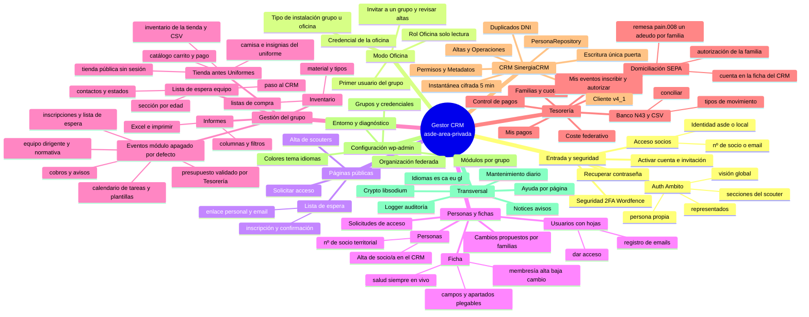
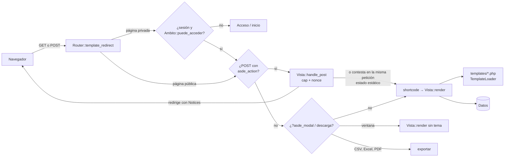
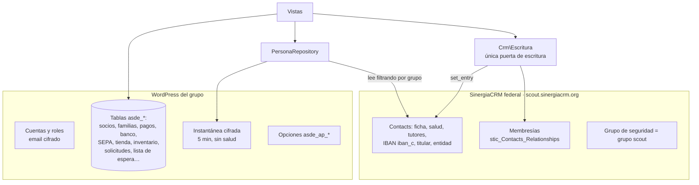

# 40 · Mapa de la aplicación (para modificarla sin perderse)

Mapa mental del plugin **«ASDE Scouts de España – Gestor CRM para Grupos Scouts»** (`asde-area-privada`):
qué partes tiene, cómo fluye una petición, dónde vive cada dato y **qué ficheros tocar para cada tipo
de cambio**. Los diagramas son Mermaid (GitHub y VS Code los dibujan). La parte final, el
**inventario**, se genera del código con la skill de usuario `mapa-area-privada`: no se edita a mano.

> Antes de cambiar algo: este mapa → `docs/00-INDICE.md` → el doc del módulo. Para un módulo
> nuevo, la skill `modulo-area-privada`; para cerrar una versión, `version-area-privada`.

## 1. Mapa mental

## 2. Cómo fluye una petición

- Cada pantalla es una **vista** (`src/Frontend/Views/*View.php`) que pinta un shortcode; las páginas
  las crea `Pages::install()` al subir la versión.
- **Sin JavaScript todo funciona**; `assets/js/` lo hace más fluido: `area.js` (ventana, confirmar,
  copiar, imprimir), `parcial.js` (filtrar y paginar sin recargar las zonas `data-asde-parcial`),
  `hojas.js`, `usuarios.js`, `informes.js`…

## 3. Dónde vive cada dato

Reglas (`CLAUDE.md`): la **salud no se guarda nunca**; lo personal, **cifrado y con caducidad**; **un
grupo no ve a otro**; **nunca** se prueba contra el CRM real ni se escribe en él desde las pruebas.

## 4. Qué tocar para cada cambio

| Quiero… | Ficheros | Ojo con |
|---|---|---|
| Cambiar un texto de una pantalla | la plantilla `templates/<módulo>/…` o la vista; después `languages/` (skill `version-area-privada` §2) | `asde_t()` y compañía; escapar al imprimir |
| Añadir un campo a un formulario | plantilla + `handle_post()` de la vista + la clase que guarda (`src/<Módulo>/…`) | sanear `$_POST`, nonce, prueba |
| Un campo nuevo de la ficha del CRM | `Fichas\CamposFicha` (grupos, opciones, solo lectura) y `Crm\PersonaRepository` (campos que se leen) | ¿dato sensible? entonces en vivo, no en la `Instantanea` |
| Escribir algo nuevo en el CRM | `Crm\Escritura` (y `Crm\Altas` para membresías) | `Permisos::puede()`; el simulado `tests/lib/CrmSimulado.php` |
| Un módulo nuevo | skill `modulo-area-privada` (tabla, vista, página, caps, `Modulos`, menú, inicio, emails, tarea diaria, desinstalar) | nace apagado (`Modulos::POR_DEFECTO_APAGADOS`) |
| Quién puede hacer qué | `Install\Roles` (capabilities) + `Auth\Ambito` (sobre quién) | se aplica al subir la versión |
| Menú o tarjetas del inicio | `Frontend\Menu::grupos()` y `templates/area/inicio.php` (+ `AreaPrivadaView` para «Pendiente de revisar») | contadores baratos (sin CRM) |
| Un email nuevo | clase con `asunto()/html()/enviar()` + `templates/email/…` + tipo en `Usuarios\RegistroEmails::TIPOS` | idioma de quien lo recibe, destino enmascarado |
| Tarea automática diaria | `Install\Mantenimiento` | sin CRM si no hace falta |
| La tienda (catálogo, carrito, pago) | `src/Tienda/` (`Servicio`, `ProductosTable`, `VariantesTable`, `PedidosTable`, `Avisos`), vistas `Tienda*View`, plantillas `templates/tienda/` | las existencias solo con `VariantesTable::reservar/devolver` (una sentencia); el precio, siempre del servidor |
| La tienda pública (sin sesión) | `Frontend\Views\TiendaPublicaView`, `Tienda\Enlace`, `Servicio::comprar_invitado` | solo lo «para todos»; datos del invitado cifrados (`PedidosTable::invitado`) y borrados a los 90 días |
| Calendario de tareas de un evento | `src/Eventos/` (`Tareas`, `TareasTable`, `Plantillas`, `AvisosTareas`), pestaña `templates/eventos/calendario.php` | fechas con `Tareas::calcular`; las comprobaciones automáticas en `Tareas::comprobar` |
| Tesorería, cuotas, pagos | `src/Tesoreria/` (`Calculadora`, `Pagos`, `FamiliasTable`), vistas `Tesoreria*View` | la familia es la unidad de pago |
| Domiciliación SEPA | `src/Sepa/` (`Mandatos`, `Remesas`, `Pain008`, `Iban`, `Avisos`, `Config`, `CuentaCrm`), `MisPagosView`, `SepaView`, `FichaView` (apartado de datos bancarios) | doc 25 §9: la cuenta está en la ficha del CRM (no en la web) y se comprueba con la huella; una remesa = un adeudo por familia |
| Estilos | al **final** de `assets/css/area-privada.css`, en un bloque con la versión | sin colores fijos (prueba `colores.php`); móvil a 390 px |
| JavaScript | `assets/js/…` y sus textos en `Idiomas\TextosJs::LISTA` | probar en el banco estático (skill de versión §5) |
| Ayuda de una página | `manual/fuentes/*.html` con `data-paginas="<clave>"` y `php herramientas/generar-manuales.php` | cambia el plugin (`ayuda/`) |
| Ajuste de wp-admin | `src/Admin/*Page.php` | textos con `__()` |

## 5. Inventario (generado)

<!-- inventario:inicio -->
_Generado con la skill `mapa-area-privada` (`scripts/inventario.php`) el 2026-10-22 · plugin 0.51.0. No editar a mano: se regenera._

### Páginas (Frontend\Pages + Router)

| Clave | Slug | Shortcode → vista | Pública | Ventana |
|---|---|---|---|---|
| `area` | area-privada | `[asde_area_privada]` → `AreaPrivadaView` |  |  |
| `alta` | alta-usuarios | `[asde_alta_usuarios]` → `AltaUsuariosView` |  | sí |
| `usuarios` | usuarios | `[asde_usuarios]` → `UsuariosView` |  |  |
| `emails` | emails | `[asde_emails]` → `EmailsView` |  |  |
| `personas` | personas | `[asde_personas]` → `PersonasView` |  | sí |
| `ficha` | ficha | `[asde_ficha]` → `FichaView` |  | sí |
| `cambios` | cambios-pendientes | `[asde_cambios]` → `CambiosView` |  | sí |
| `informes` | informes | `[asde_informes]` → `InformesView` |  |  |
| `tesoreria` | tesoreria | `[asde_tesoreria]` → `TesoreriaView` |  | sí |
| `familias` | familias | `[asde_familias]` → `FamiliasView` |  |  |
| `cuotas` | cuotas | `[asde_cuotas]` → `CuotasView` |  |  |
| `federacion` | coste-federativo | `[asde_coste_federativo]` → `FederacionView` |  |  |
| `banco` | banco | `[asde_banco]` → `BancoView` |  | sí |
| `sepa` | domiciliaciones | `[asde_sepa]` → `SepaView` |  |  |
| `seguridad` | seguridad | `[asde_seguridad]` → `SeguridadView` |  |  |
| `acceso` | acceso | `[asde_acceso]` → `AccesoView` | sí |  |
| `activar` | activar-cuenta | `[asde_activar_cuenta]` → `ActivarCuentaView` | sí |  |
| `recuperar` | recuperar-contrasena | `[asde_recuperar]` → `RecuperarView` | sí |  |
| `solicitar` | solicitar-acceso | `[asde_solicitar]` → `SolicitarView` | sí |  |
| `solicitudes` | solicitudes | `[asde_solicitudes]` → `SolicitudesView` |  | sí |
| `tienda_pedidos` | mis-pedidos | `[asde_tienda_pedidos]` → `TiendaPedidosView` |  |  |
| `tienda_gestion` | gestion-pedidos | `[asde_tienda_gestion]` → `TiendaGestionView` |  | sí |
| `tienda_config` | configuracion | `[asde_tienda_config]` → `TiendaConfigView` |  |  |
| `tienda_productos` | productos | `[asde_tienda_productos]` → `TiendaProductosView` |  |  |
| `tienda_proveedor` | pedido-de-camisas | `[asde_tienda_proveedor]` → `TiendaProveedorView` |  |  |
| `pagos` | mis-pagos | `[asde_mis_pagos]` → `MisPagosView` |  |  |
| `alta_scouters` | alta-scouters | `[asde_alta_scouters]` → `AltaScoutersView` | sí |  |
| `alta_grupo` | alta-grupo | `[asde_alta_grupo]` → `AltaGrupoView` | sí |  |
| `inventario` | inventario | `[asde_inventario]` → `InventarioView` |  | sí |
| `inventario_tipos` | tipos-de-material | `[asde_inventario_tipos]` → `InventarioTiposView` |  | sí |
| `inventario_compras` | listas-de-compra | `[asde_inventario_compras]` → `InventarioComprasView` |  | sí |
| `lista_espera` | lista-de-espera | `[asde_lista_espera]` → `ListaEsperaView` |  |  |
| `tienda_publica` | tienda | `[asde_tienda_publica]` → `TiendaPublicaView` | sí |  |
| `inscripcion_espera` | inscripcion-lista-de-espera | `[asde_inscripcion_espera]` → `InscripcionEsperaView` | sí |  |
| `eventos` | eventos | `[asde_eventos]` → `EventosView` |  |  |
| `eventos_config` | configuracion | `[asde_eventos_config]` → `EventosConfigView` |  |  |
| `eventos_recetas` | recetas | `[asde_eventos_recetas]` → `RecetasView` |  |  |
| `mis_eventos` | mis-eventos | `[asde_mis_eventos]` → `MisEventosView` |  |  |
| `reintegros` | reintegros | `[asde_reintegros]` → `ReintegrosView` |  |  |

### Capabilities por rol (Install\Roles)

| Capability | Scouter / Voluntario | Secretaría | Coordinación | Oficina | Tesorería | Tutor / Padre / Madre | Participante | Intendente (responsable de material) |
|---|---|---|---|---|---|---|---|---|
| `asde_access_area_privada` | ✓ | ✓ | ✓ | ✓ | ✓ | ✓ | ✓ | ✓ |
| `asde_add_self_notes` |  |  |  |  |  |  | ✓ |  |
| `asde_annotate_health` |  |  | ✓ |  |  |  |  |  |
| `asde_approve_changes` | ✓ | ✓ | ✓ |  |  |  |  |  |
| `asde_aprobar_solicitudes` | ✓ | ✓ | ✓ |  |  |  |  |  |
| `asde_crm_sync` |  |  | ✓ |  |  |  |  |  |
| `asde_edit_all` |  | ✓ |  |  |  |  |  |  |
| `asde_edit_section_contact` | ✓ |  |  |  |  |  |  |  |
| `asde_edit_self_contact` | ✓ |  |  |  |  |  | ✓ | ✓ |
| `asde_eventos_config` |  |  | ✓ |  | ✓ |  |  |  |
| `asde_eventos_economia` |  |  |  |  | ✓ |  |  |  |
| `asde_eventos_gestion` | ✓ | ✓ | ✓ |  |  |  |  |  |
| `asde_eventos_grupo` |  |  | ✓ |  |  |  |  |  |
| `asde_eventos_inscribir` | ✓ | ✓ | ✓ |  | ✓ | ✓ | ✓ | ✓ |
| `asde_eventos_material` |  |  |  |  |  |  |  | ✓ |
| `asde_inventario` | ✓ | ✓ | ✓ |  | ✓ |  |  | ✓ |
| `asde_inventario_aprobar` |  |  |  |  | ✓ |  |  |  |
| `asde_lista_espera` | ✓ | ✓ | ✓ |  | ✓ |  |  |  |
| `asde_lista_espera_alta` |  | ✓ | ✓ |  |  |  |  |  |
| `asde_manage_users` |  | ✓ | ✓ | ✓ |  |  |  |  |
| `asde_menus_recetas` | ✓ | ✓ | ✓ |  |  |  |  |  |
| `asde_mis_pagos` | ✓ | ✓ | ✓ |  | ✓ | ✓ | ✓ | ✓ |
| `asde_multigrupo` |  |  |  | ✓ |  |  |  |  |
| `asde_propose_ward_changes` |  |  |  |  |  | ✓ |  |  |
| `asde_reintegros` | ✓ |  | ✓ |  |  |  |  |  |
| `asde_reintegros_aprobar` |  |  |  |  | ✓ |  |  |  |
| `asde_reintegros_pagar` |  |  | ✓ |  | ✓ |  |  |  |
| `asde_reports` | ✓ | ✓ | ✓ | ✓ | ✓ |  |  |  |
| `asde_sepa_autorizar` |  |  |  |  |  | ✓ | ✓ |  |
| `asde_solo_lectura` |  |  |  | ✓ |  |  |  |  |
| `asde_tesoreria_acceso` | ✓ | ✓ | ✓ |  | ✓ |  |  |  |
| `asde_tesoreria_config` |  | ✓ | ✓ |  | ✓ |  |  |  |
| `asde_tienda_admin` |  | ✓ | ✓ |  | ✓ |  |  |  |
| `asde_tienda_comprar` | ✓ | ✓ | ✓ |  | ✓ | ✓ | ✓ | ✓ |
| `asde_tienda_entrega` | ✓ | ✓ | ✓ |  | ✓ |  |  |  |
| `asde_tienda_gestion` | ✓ | ✓ | ✓ |  | ✓ |  |  |  |
| `asde_tienda_pago` |  |  |  |  | ✓ |  |  |  |
| `asde_tienda_pedido` |  |  | ✓ |  |  |  |  |  |
| `asde_view_all` |  | ✓ | ✓ |  |  |  |  |  |
| `asde_view_health` | ✓ | ✓ | ✓ | ✓ |  |  |  |  |
| `asde_view_section` | ✓ |  |  |  |  |  |  |  |
| `asde_view_self` | ✓ | ✓ | ✓ |  | ✓ |  | ✓ | ✓ |
| `asde_view_wards` |  |  |  |  |  | ✓ |  |  |

### Módulos que se encienden por grupo (Domain\Modulos)

| Módulo | Qué es | Capabilities que quita | Depende de | Por defecto |
|---|---|---|---|---|
| `tesoreria` Tesorería | Control de pagos, familias, cuotas y coste federativo. | `asde_tesoreria_acceso`, `asde_tesoreria_config`, `asde_sepa_autorizar` | — | encendido |
| `banco` Banco | Importar los movimientos de la cuenta, conciliarlos y tipificar los gastos. | — | tesoreria | encendido |
| `sepa` Domiciliaciones SEPA | Autorizaciones de las familias y ficheros de adeudos para el banco. | `asde_sepa_autorizar` | tesoreria | encendido |
| `tienda` Tienda | Productos del grupo (uniforme, insignias y más): pedidos, pago y entrega. | `asde_tienda_comprar`, `asde_tienda_gestion`, `asde_tienda_pago`, `asde_tienda_pedido`, `asde_tienda_entrega`, `asde_tienda_admin` | — | encendido |
| `inventario` Inventario | Material del grupo, tipos y listas de compra. | `asde_inventario`, `asde_inventario_aprobar` | — | encendido |
| `informes` Informes | Listados con las columnas que se elijan. | `asde_reports` | — | encendido |
| `solicitudes` Solicitudes de acceso | El enlace del grupo para pedir el acceso y su revisión. | `asde_aprobar_solicitudes` | — | encendido |
| `alta_scouters` Alta de scouters | El enlace para que los scouters se den de alta. | — | — | encendido |
| `lista_espera` Lista de espera | El enlace para apuntarse a la lista de espera, la lista para el equipo y el paso al CRM. | `asde_lista_espera`, `asde_lista_espera_alta` | — | apagado |
| `eventos` Eventos | Salidas, acampadas y otras actividades: equipo dirigente, presupuesto, inscripciones, «Mis eventos» y cobros. | `asde_eventos_gestion`, `asde_menus_recetas`, `asde_eventos_grupo`, `asde_eventos_economia`, `asde_eventos_config`, `asde_eventos_inscribir`, `asde_eventos_material` | — | apagado |
| `reintegros` Reintegros | Los scouters piden que les devuelvan un gasto (con el justificante y, si procede, un evento); Tesorería lo aprueba y Tesorería o Coordinación lo marcan pagado. | `asde_reintegros`, `asde_reintegros_aprobar`, `asde_reintegros_pagar` | — | apagado |

### Tablas propias (`{prefix}asde_*`)

| Tabla | Clase |
|---|---|
| `asde_auditoria` | `src/Audit/Logger.php` |
| `asde_crm_operaciones` | `src/Crm/Operaciones.php` |
| `asde_grupo_invitaciones` | `src/Domain/GrupoInvitaciones.php` |
| `asde_grupo_solicitudes` | `src/Domain/GrupoSolicitudes.php` |
| `asde_evento_anticipos` | `src/Eventos/AnticiposTable.php` |
| `asde_eventos` | `src/Eventos/EventosTable.php` |
| `asde_evento_gastos` | `src/Eventos/GastosTable.php` |
| `asde_evento_inscripciones` | `src/Eventos/InscripcionesTable.php` |
| `asde_evento_material` | `src/Eventos/MaterialTable.php` |
| `asde_evento_movimientos` | `src/Eventos/MovimientosTable.php` |
| `asde_evento_partidas` | `src/Eventos/PartidasTable.php` |
| `asde_evento_tareas` | `src/Eventos/TareasTable.php` |
| `asde_cambios` | `src/Fichas/Cambios.php` |
| `asde_informes` | `src/Informes/InformesTable.php` |
| `asde_inventario_compras` | `src/Inventario/ComprasTable.php` |
| `asde_inventario` | `src/Inventario/MaterialesTable.php` |
| `asde_inventario_tipos` | `src/Inventario/TiposTable.php` |
| `asde_lista_espera` | `src/ListaEspera/Inscripciones.php` |
| `asde_evento_menu_avisos` | `src/Menus/AvisosTable.php` |
| `asde_menu_ingredientes` | `src/Menus/IngredientesTable.php` |
| `asde_evento_menu` | `src/Menus/MenuTable.php` |
| `asde_menu_recetas` | `src/Menus/RecetasTable.php` |
| `asde_menu_receta_lineas` | `src/Menus/RecetasTable.php` |
| `asde_reintegros` | `src/Reintegros/ReintegrosTable.php` |
| `asde_sepa_mandatos` | `src/Sepa/Mandatos.php` |
| `asde_sepa_remesas` | `src/Sepa/Remesas.php` |
| `asde_socios` | `src/Socios/SociosTable.php` |
| `asde_banco_movimientos` | `src/Tesoreria/Banco/BancoTable.php` |
| `asde_banco_lotes` | `src/Tesoreria/Banco/BancoTable.php` |
| `asde_banco_tipos` | `src/Tesoreria/Banco/TiposMovimiento.php` |
| `asde_familias` | `src/Tesoreria/FamiliasTable.php` |
| `asde_familia_miembros` | `src/Tesoreria/FamiliasTable.php` |
| `asde_movimientos` | `src/Tesoreria/MovimientosTable.php` |
| `asde_tienda_pedidos` | `src/Tienda/PedidosTable.php` |
| `asde_tienda_productos` | `src/Tienda/ProductosTable.php` |
| `asde_tienda_proveedor` | `src/Tienda/ProveedorTable.php` |
| `asde_tienda_variantes` | `src/Tienda/VariantesTable.php` |
| `asde_emails` | `src/Usuarios/RegistroEmails.php` |
| `asde_solicitudes` | `src/Usuarios/Solicitudes.php` |

### Clases (`src/`)

**Admin/**

- `ColoresPage` — wp-admin → Grupos Scouts → Colores (v0.15, doc 28):
- `DuplicadosPage` — wp-admin → Grupos Scouts → Documentos repetidos (v0.24, doc 34, §3.7):
- `EntornoPage` — wp-admin → Grupos Scouts → Instalación y entorno.
- `GruposAltasPage` — wp-admin → Grupos Scouts → Altas de grupos (v0.50, doc 50 fase 6; solo en la web de la oficina).
- `GruposInvitacionesPage` — wp-admin → Grupos Scouts → Invitar a un grupo (v0.50, doc 50 fase 5; solo en la web de la oficina).
- `IdiomasPage` — wp-admin → Grupos Scouts → Idioma y etiquetas (v0.15, doc 28).
- `ModulosPage` — wp-admin → Grupos Scouts → Módulos (v0.20):
- `OrganizacionPage` — wp-admin → Grupos Scouts → Organización federada:
- `Recursos` — Estilos y JavaScript comunes de las páginas del plugin en wp-admin (v0.31).
- `SettingsPage` — Administración del plugin (solo administradores, manage_options):

**Audit/**

- `Logger` — Registro de auditoría del área privada (docs/08).

**Auth/**

- `AccessHooks` — - Los socios entran SOLO por la pantalla "Acceso socios" (grupo + nº de socio/a o su email del CRM + contraseña).
- `Ambito` — Ámbito de un usuario en esta petición, calculado desde el CRM (sin caché persistente:
- `Identificacion` — Usuario de acceso de los socios:
- `Intentos` — Límite de intentos fallidos en la pantalla de acceso:
- `Limite` — Límite de peticiones por dispositivo (IP) para los formularios públicos (p.
- `SoloLectura` — Cuentas de solo lectura (v0.50, doc 50 fase 3):

**Crm/**

- `Altas` — Altas, bajas y cambios de sección en el CRM (v0.22, doc 34, fase 2).
- `ClientFactory` — Clientes del CRM:
- `ConnectionResult` — 
- `CrmClientInterface` — Cliente de SinergiaCRM.
- `CrmException` — Error al leer del CRM.
- `Crypto` — Cifrado simétrico (libsodium) para los secretos guardados en la base de datos.
- `Duplicados` — Comprobación previa a un alta en el CRM (doc 34, fase 1):
- `EscritorCrm` — Lo mínimo para escribir en el CRM y comprobar lo escrito.
- `Escritura` — Única puerta de escritura en el CRM.
- `Instantanea` — Instantánea de las fichas del grupo (v0.12.3):
- `Metadatos` — Definición de los campos de un módulo según el propio CRM (tipo, opciones de los desplegables, longitud, obligatorio, calculado).
- `Operaciones` — Operaciones de alta en el CRM a medias o hechas (v0.22, doc 34, §3.5 y §3.6).
- `Permisos` — Qué puede hacer en el CRM el usuario de API del grupo en el que se trabaja (ACL por módulo de get_available_modules).
- `PersonaRepository` — Lectura de personas (Contacts) del CRM de ASDE.
- `Query` — Construcción segura de fragmentos WHERE para la API v4_1 (que recibe SQL crudo).
- `Settings` — Configuración común de la conexión con SinergiaCRM:
- `SinergiaV41Client` — API REST legacy v4_1 de SinergiaCRM (la que documenta su wiki).

**Domain/**

- `ClaveDeGrupo` — Clave secreta de un enlace público del grupo (alta de scouters, lista de espera):
- `Grupo` — Grupo Scout en el que se trabaja en esta petición:
- `GrupoAltas` — Revisión de las altas de grupo (v0.50, doc 50 fase 6; solo en la web de la oficina):
- `GrupoInvitaciones` — Invitaciones para que un grupo dé de alta su acceso (v0.50, doc 50 fase 5; solo en la web de la oficina).
- `GrupoSolicitudes` — Altas de grupo recibidas por el formulario de una invitación (v0.50, doc 50 fases 5 y 6; solo en la web de la oficina).
- `Grupos` — Grupos Scouts dados de alta en la web (a mano, por un administrador).
- `Identidad` — Qué número es el USUARIO DE ACCESO (v0.14, doc 27).
- `Modulos` — Módulos del área privada que se pueden activar o desactivar por grupo (v0.20; wp-admin → Grupos Scouts → Módulos, Admin\ModulosPage).
- `NumeroSocio` — Nº de socio/a local/territorial.
- `Oficina` — Credencial del CRM de la oficina federal (v0.50, doc 50 fase 2).
- `Organizacion` — Organización federada de Scouts de España que usa el sistema (opción `asde_ap_organizacion`).
- `Persona` — Persona del CRM (Contacts) con los campos que necesita el área privada.
- `Secciones` — Catálogo de secciones de ASDE (docs/05-secciones-educativas.md).
- `VerificacionGrupo` — Comprueba la credencial del CRM que escribe un grupo al darse de alta (v0.50, doc 50 fase 5):

**Eventos/**

- `AnticiposTable` — Anticipos de caja de un evento ({prefix}asde_evento_anticipos, v0.36, doc 43, apartado 4):
- `Avisos` — Avisos de los eventos (v0.35, P-152):
- `AvisosTareas` — Avisos del calendario de tareas (doc 49, fase A2, P-186):
- `Cobros` — Cobro de las inscripciones (v0.35, doc 43, apartado 4):
- `Config` — Configuración de los eventos de cada grupo (opción asde_ap_eventos_<grupo>, doc 43):
- `Cuentas` — Las cuentas de un evento (v0.36, doc 43:
- `EventosTable` — Eventos del grupo ({prefix}asde_eventos, doc 43):
- `GastosTable` — Gastos e ingresos reales de un evento ({prefix}asde_evento_gastos, v0.36, doc 43:
- `Inscripciones` — Inscripciones a los eventos (v0.35, doc 43, apartado 3).
- `InscripcionesTable` — Personas de un evento ({prefix}asde_evento_inscripciones, doc 43):
- `Justificantes` — Justificantes de los gastos de un evento (v0.36, doc 43):
- `Material` — El material de un evento (v0.42, doc 43 apartado 5):
- `MaterialTable` — El material de un evento ({prefix}asde_evento_material, v0.42):
- `MovimientosTable` — Cobros de los eventos ({prefix}asde_evento_movimientos, doc 43, apartado 4):
- `Normativa` — Lo que pide la normativa de tiempo libre de las Illes Balears y cómo trabaja hoy el grupo (doc 43, apartado 6; Ley 10/2022 y Decreto 23/2018).
- `PartidasTable` — Partidas del presupuesto de un evento ({prefix}asde_evento_partidas, doc 43, apartado 4).
- `Plantillas` — Plantillas de tareas de los eventos (doc 49, fase A1):
- `Presupuesto` — El precio de un evento sale de su coste (P-145, doc 43, apartado 4):
- `Servicio` — Eventos del grupo (v0.35, doc 43):
- `Tareas` — Calendario de tareas de un evento (doc 49, fase A1):
- `TareasTable` — Calendario de tareas de un evento ({prefix}asde_evento_tareas, doc 49, fase A1):

**Fichas/**

- `Cambios` — Cola de cambios propuestos ({prefix}asde_cambios, docs/07):
- `CamposFicha` — Campos de la ficha de una persona:
- `FichaService` — Ficha de una persona:
- `PermisosFicha` — Qué puede hacer un usuario con cada campo de la ficha de una persona (matriz de docs/02, aplicada al ámbito de docs/12):

**Frontend/**

- `AltaSocio` — Personas → «Alta de socio/a» (v0.23, doc 34, fase 3):
- `Ayuda` — Ayuda de cada página del área privada (v0.26, petición del usuario:
- `Colores` — Colores del área privada (v0.15, doc 28):
- `Menu` — Menú del área privada, separado por tipo de usuario (v0.15, doc 28).
- `Notices` — Avisos de un solo uso para el usuario conectado (patrón POST → redirect → GET).
- `Pages` — Páginas del área privada:
- `Router` — 
- `Tabla` — Ordenación por columnas y paginación de los listados del área privada.
- `Tema` — El tema de WordPress y el área privada (v0.15, doc 28).
- `TemplateLoader` — Plantillas sobreescribibles desde el tema:

**Frontend/Views/**

- `AccesoView` — Pantalla de acceso al área privada (pública):
- `ActivarCuentaView` — Página pública:
- `AltaGrupoView` — «Alta de grupo» (pública, v0.50, doc 50 fase 5):
- `AltaScoutersView` — «Alta de scouters» (pública, v0.16, doc 31):
- `AltaUsuariosView` — Alta de usuarios:
- `AreaPrivadaView` — 
- `AyudaView` — Ayuda del área privada (v0.26, ver Frontend\Ayuda):
- `BancoView` — Tesorería → Banco:
- `CambiosView` — Bandeja de cambios propuestos por las cuentas familiares.
- `CuotasView` — Configuración de las cuotas que paga cada familia (por ronda):
- `EmailsView` — Registro de emails del grupo:
- `EventosBaseView` — Base de las páginas de eventos:
- `EventosConfigView` — Configuración de los eventos del grupo (Coordinación y Tesorería):
- `EventosView` — Eventos del grupo (v0.35, doc 43):
- `FamiliasView` — Familias:
- `FederacionView` — Coste que paga el grupo a su organización federada:
- `FichaView` — Ficha de una persona con todos los datos que el usuario puede ver.
- `InformesView` — Generador de informes:
- `InscripcionEsperaView` — «Inscripción en la lista de espera» (pública, v0.32, doc 39).
- `InventarioBaseView` — Base de las páginas del inventario:
- `InventarioComprasView` — Listas de compra de material (doc 32):
- `InventarioTiposView` — Tipos de material (doc 32):
- `InventarioView` — Inventario de material del grupo (doc 32):
- `ListaEsperaView` — Lista de espera (v0.32, doc 39) para scouters, Secretaría, Coordinación y Tesorería:
- `MisEventosView` — «Mis eventos» (v0.35, doc 43):
- `MisPagosView` — «Mis pagos» (petición del usuario, 2026-09-29):
- `PersonasView` — Personas del grupo, activas y NO activas:
- `RecetasView` — El recetario del grupo (v0.41, doc 49, B1):
- `RecuperarView` — "¿Has olvidado tu contraseña?" (pública).
- `ReintegrosView` — Reintegros (v0.47, doc 53):
- `SeguridadView` — Seguridad de la cuenta:
- `SepaView` — Tesorería · Domiciliaciones SEPA (Secretaría, Coordinación y Tesorería):
- `SolicitarView` — «Solicitar acceso» (pública):
- `SolicitudesView` — Solicitudes de acceso (scouters, Secretaría y Coordinación):
- `TesoreriaBaseView` — Base de las páginas de Tesorería:
- `TesoreriaView` — Tesorería · control de pagos:
- `TiendaBaseView` — Base de las páginas de la tienda:
- `TiendaConfigView` — Configuración de la tienda del grupo (Coordinación, Tesorería y Secretaría):
- `TiendaGestionView` — Gestión de los pedidos de la tienda (scouters, Tesorería, Coordinación y administración):
- `TiendaPedidosView` — «Mis pedidos» para los asociados:
- `TiendaProductosView` — Productos de la tienda (doc 48, fase 2):
- `TiendaProveedorView` — «Pedido de camisas» (v0.48, doc 48, T4):
- `TiendaPublicaView` — La tienda pública (v0.39, doc 48, fase 4, P-174):
- `UsuariosView` — Listado de usuarios del área privada:
- `View` — 

**Frontend/**

- `Visibilidad` — Las páginas del área privada no aparecen en ningún listado público:

**Idiomas/**

- `Extractor` — Busca en el código los textos que se pueden traducir:
- `Idioma` — Idiomas del área privada (v0.15, doc 28):
- `Textos` — Textos que el código tiene en constantes (una constante no puede llamar a asde_t()) y que se traducen al mostrarlos:
- `TextosJs` — Textos que escriben los JavaScript del área privada.
- `Traducciones` — Textos del área privada en cada idioma (v0.15, doc 28).
- `funciones` — 

**Informes/**

- `Catalogo` — Columnas disponibles en el generador de informes (campos del CRM de ASDE, ver docs/04 §7.3).
- `Generador` — Ejecuta un informe contra el CRM, siempre dentro del ámbito del usuario:
- `Informe` — Definición de un informe:
- `InformesTable` — Definiciones de informes guardados ({prefix}asde_informes).
- `Xlsx` — Hoja de cálculo .xlsx (v0.29):

**Install/**

- `AppRetirada` — La app móvil (PWA) es un plugin aparte desde la 0.18 (`asde-area-privada-app`, repo GestorCRM-App).
- `Entorno` — «Generar el entorno»:
- `Installer` — 
- `Mantenimiento` — Tarea diaria (WP-Cron):
- `MigracionTienda` — v0.39 (doc 48):
- `Roles` — Roles y capabilities del área privada (docs/02-roles-y-permisos.md).

**Integraciones/**

- `Wordfence` — Verificación en dos pasos (2FA) con Wordfence Login Security.

**Inventario/**

- `AvisoRevision` — Email a quien pidió una lista de compra cuando Tesorería le da el visto bueno o la rechaza (v0.30, P-65; ).
- `AvisoTesoreria` — Email a Tesorería cuando alguien crea una lista de compra de material:
- `ComprasTable` — Listas de compra de material ({prefix}asde_inventario_compras).
- `Importador` — Importar material al inventario desde un CSV (petición del usuario, 2026-10-05, doc 32).
- `ListaPdf` — PDF para imprimir una lista de compra con el visto bueno de Tesorería:
- `MaterialesTable` — Material y equipamiento del grupo ({prefix}asde_inventario):
- `Pdf` — Escritor de PDF mínimo (PDF 1.4) para documentos sencillos de texto y tablas, sin librerías externas:
- `Servicio` — Inventario de material del grupo y listas de compra (petición del usuario, 2026-10-05, doc 32).
- `TiposTable` — Tipos de material del inventario de cada grupo ({prefix}asde_inventario_tipos).

**ListaEspera/**

- `Avisos` — Emails de la lista de espera (v0.32, doc 39), todos con la plantilla email/lista-espera, en el idioma en que se apuntó la persona y con el email de contacto del grupo como «Respond
- `CamposExtra` — Preguntas propias de cada grupo en el formulario de la lista de espera (v0.38, doc 46).
- `Enlaces` — Enlaces de la lista de espera (v0.32, doc 39).
- `Formulario` — Lo que se pide al apuntarse a la lista de espera y cómo se valida (v0.32, doc 39).
- `Inscripciones` — Lista de espera (v0.32, doc 39):

**Menus/**

- `Alergenos` — Los 14 alérgenos de declaración obligatoria (Reglamento (UE) 1169/2011) y lo que se deriva de ellos (doc 49, B1).
- `AvisoAlergenos` — Aviso de «alérgenos sin resolver» en el menú de un evento (doc 49, P-192, v0.43).
- `AvisosTable` — Las confirmaciones de los avisos de alérgenos de un menú ({prefix}asde_evento_menu_avisos, doc 49, B3, P-191).
- `Biblioteca` — La biblioteca básica común (doc 49, P-195):
- `Conversion` — Utilidades pequeñas de texto de los menús.
- `Escalado` — Unidades y escalado de las recetas (doc 49, B1).
- `HojaCocina` — La hoja de cocina de un evento (doc 49, B3, apartado 9.1):
- `IngredientesTable` — Ingredientes ({prefix}asde_menu_ingredientes, doc 49, B1).
- `MenuEvento` — El menú de un evento (doc 49, B2):
- `MenuTable` — Las comidas del menú de un evento ({prefix}asde_evento_menu, doc 49, B2):
- `Recetario` — El recetario del grupo (doc 49, B1):
- `RecetasTable` — Recetas ({prefix}asde_menu_recetas) y sus líneas ({prefix}asde_menu_receta_lineas), doc 49, B1.
- `SelectorAlergenos` — El selector de alérgenos de la ficha de salud (v0.41, doc 49, B3) y el intérprete de lo que se guardó.
- `Validacion` — Valida el menú de un evento contra la alimentación de quienes van (doc 49, B3).

**(raíz)/**

- `Plugin` — 

**Reintegros/**

- `Avisos` — Emails de los reintegros (v0.47, doc 53).
- `ReintegrosTable` — Reintegros de gastos de los scouters ({prefix}asde_reintegros, v0.47, doc 53):
- `Servicio` — Reintegros de gastos (v0.47, doc 53):

**Sepa/**

- `Avisos` — Emails de la domiciliación SEPA:
- `Config` — Datos del acreedor para las domiciliaciones SEPA de cada grupo (opción asde_ap_sepa_<grupo>):
- `CuentaCrm` — La cuenta bancaria de la domiciliación, en la ficha del CRM (v0.33, doc 25 §9; decisión del usuario, P-131):
- `Iban` — IBAN:
- `Mandatos` — Autorizaciones (mandatos) de adeudo directo SEPA ({prefix}asde_sepa_mandatos).
- `Pain008` — Fichero de adeudos directos SEPA Core (ISO 20022 pain.008.001.02, el que aceptan los bancos españoles como «Cuaderno 19.14»).
- `Remesas` — Remesas de adeudos SEPA ({prefix}asde_sepa_remesas):
- `Texto` — Texto para los ficheros SEPA:

**Socios/**

- `Eliminadas` — «Eliminar de la web» a una persona SIN membresía activa (v0.35.1, petición del usuario).
- `Numeracion` — Números de socio:
- `Numeros` — Cómo se ven los números de socio/a de una persona en las pantallas (v0.14, doc 27).
- `SociosTable` — Tabla de equivalencias {prefix}asde_socios:
- `TareaNumeracion` — Correcciones masivas de números de socio EN SEGUNDO PLANO (una tarea por grupo).

**Tesoreria/Banco/**

- `BancoTable` — Movimientos del banco importados de ficheros (Norma 43 o CSV), por grupo:
- `Codificacion` — Juego de caracteres de los ficheros del banco.
- `Conciliacion` — Conciliación de los ingresos del banco con las familias:
- `CsvBanco` — Lector de movimientos en CSV (p.
- `Norma43` — Lector de ficheros Norma 43 (Cuaderno 43 de AEB, CECA y UNACC, junio de 2012):
- `TiposMovimiento` — Tipos de los movimientos del banco que no son cuotas (v0.20, doc 16):

**Tesoreria/**

- `Calculadora` — Cálculos de Tesorería (sin efectos secundarios):
- `Config` — Configuración de Tesorería por ronda solar (septiembre → agosto), opción `asde_ap_tesoreria`.
- `FamiliasTable` — Familias:
- `HistorialPagos` — Los pagos de una familia que no son de la cuota de la ronda (v0.37, petición del usuario:
- `MovimientosTable` — Movimientos de Tesorería por familia y ronda ({prefix}asde_movimientos):
- `Pagos` — Eliminar un pago (o un ajuste) de una familia y su historial (v0.25, petición del usuario:
- `Sugerencias` — Sugiere familias a partir del CRM:

**Tienda/**

- `Avisos` — Emails de la tienda (v0.39, doc 48, P-182):
- `ConciliacionBanco` — Pedidos de la tienda y banco (v0.40, doc 48, fase 5):
- `Config` — Configuración de los pedidos de uniforme de cada grupo (opción asde_ap_tienda_<grupo>):
- `Enlace` — Enlaces de la tienda pública (v0.39, doc 48, fase 4).
- `ImportadorProductos` — Cargar productos y existencias de la tienda desde un CSV (doc 48, fase 2), con el mismo método que el inventario de material (Inventario\Importador):
- `Informes` — Informes de ventas de la tienda (v0.40, doc 48, fase 5):
- `InventarioTienda` — La tienda sobre el inventario general (v0.51, doc 55):
- `PedidosTable` — Pedidos de uniforme ({prefix}asde_tienda_pedidos):
- `ProductosTable` — Catálogo de la tienda (doc 48, fase 2):
- `Proveedor` — Pedido de camisas (y de lo demás que se encarga al proveedor) (v0.48, doc 48, T4):
- `ProveedorTable` — Pedidos del grupo al proveedor (v0.48, doc 48, T4):
- `Sembrado` — Doc 48, fase 2:
- `Servicio` — Pedidos de la tienda (doc 48 y doc 48).
- `VariantesTable` — Variantes de los productos de la tienda ({prefix}asde_tienda_variantes) y sus existencias (doc 48, fase 2).

**Usuarios/**

- `AltaResult` — 
- `AltaScouterService` — Alta de scouters con el enlace del grupo (v0.16, doc 31; decisiones del usuario del 2026-10-03):
- `AltaService` — Alta de usuarios del área privada a partir de fichas del CRM.
- `AvisoBaja` — Aviso por email de una baja dada desde la web (v0.23.1, doc 34; decisión del usuario, P-90:
- `Contacto` — Datos de contacto de un usuario.
- `EmailCuenta` — Email de cada cuenta del área privada, guardado en WordPress (decisión del usuario, 2026-09-28:
- `EmailRechazo` — Aviso por email a quien pidió el acceso cuando se rechaza su solicitud (P-36, decidido el 2026-09-30).
- `EnlaceScouters` — Enlace de alta para scouters (v0.16, doc 31):
- `Invitacion` — Enlaces de un solo uso para activar la cuenta (invitación) o elegir una contraseña nueva (recuperación).
- `Listado` — Datos del listado de usuarios del área privada (v0.12.2).
- `MigracionUsuario` — Pasa el usuario de las cuentas existentes al número que se ha elegido como usuario de acceso (v0.14, doc 27):
- `RegistroEmails` — Registro de los emails que envía el área privada ({prefix}asde_emails):
- `SolicitudService` — Solicitudes de acceso (petición del usuario, 2026-09-28).
- `Solicitudes` — Solicitudes de acceso al área privada (tabla {prefix}asde_solicitudes).
- `Usuarios` — Vínculo entre usuarios de WordPress y el CRM.

### JavaScript (`assets/js/`)

- `admin.js` — Páginas del plugin en wp-admin (v0.31: antes, onsubmit/onclick en las plantillas; WordPress pide no poner JavaScript en ellas).
- `alergenos.js` — Selector de alérgenos de la ficha de salud (mejora progresiva: sin JavaScript queda el campo de texto).
- `alta.js` — Alta de usuarios: mejora progresiva (el formulario funciona sin JS y todo se vuelve a comprobar en el servidor).
- `area.js` — Área privada (mejora progresiva: sin JavaScript los enlaces abren la página).
- `banco.js` — Tesorería → Banco (v0.20, doc 16).
- `cabecera.js` — Área privada: plegar o desplegar la cabecera morada del tema para ganar espacio.
- `colores.js` — wp-admin → Grupos Scouts → Colores: selectores de color y vista previa en vivo.
- `combobox.js` — Desplegable predictivo: convierte un <select class="asde-combobox"> en un campo de texto que empieza a buscar a partir de la 3.ª letra (data-min) y sugiere las 
- `conceptos.js` — «Otros conceptos» del coste federativo: botón para añadir filas (sin JavaScript hay siempre una fila vacía para añadir de uno en uno).
- `ficha.js` — Ficha de una persona (mejora progresiva: sin JavaScript todo sigue funcionando).
- `hojas.js` — Hojas de la sección «Usuarios» (v0.25): Usuarios, Dar acceso y Registro de emails son hojas de un mismo libro, como en una hoja de cálculo (templates/usuarios/h
- `imprimir.js` — Botón «Imprimir» de las páginas propias para imprimir (v0.31; antes, onclick en la plantilla): cualquier elemento con data-asde-imprimir-pagina abre el cuadro d
- `informes.js` — Informes (mejora progresiva: sin JavaScript todo funciona igual).
- `inventario.js` — Inventario de material (v0.19, doc 32).
- `parcial.js` — Zonas que se actualizan sin recargar la página (v0.20; primero, el listado del banco).
- `reintegros.js` — Reintegros (v0.47, doc 53): el campo del IBAN solo se enseña si se elige cobrar por transferencia.
- `sw-retirada.js` — Service worker de «app retirada» (src/Install/AppRetirada.php).
- `tarea.js` — Monitor de la corrección de números en segundo plano.
- `tesoreria.js` — Tesorería → ficha de una familia (v0.20; ventana con buscador desde la v0.20.1).
- `tienda.js` — Tienda (v0.45, doc 48, T2): en los productos con varias tallas se ve una fila «cantidad + talla» y el botón «Añadir otra talla» enseña las siguientes.
- `usuarios.js` — Listado de usuarios: filtra por columna, ordena y pagina en memoria.

### Pruebas (`tests/`)

`acceso` · `alta-grupo-aprobacion` · `alta-grupo-invitacion` · `alta-grupo-primer-usuario` · `alta-reglas` · `alta-scouters` · `altas-crm-escritura` · `altas-crm-pantallas` · `altas-crm` · `app-enganches` · `ayuda` · `banco-gestion` · `colores` · `entorno` · `estilo-wordpress` · `eventos-avisos-config` · `eventos-calendario` · `eventos-economia` · `eventos-inscripciones` · `eventos-intendente` · `eventos-material` · `eventos` · `ficha-alergenos` · `fichas-escritura` · `grupos-emails-banco` · `identidad` · `idiomas-catalogos` · `idiomas` · `inventario` · `lista-espera` · `mejoras-v029` · `mejoras-v030` · `mejoras-v031` · `mejoras-v034` · `mejoras-v0351` · `menus-evento` · `menus-recetario` · `menus-validacion` · `menus` · `migracion-tienda` · `modo-instalacion` · `modulos` · `oficina-pantallas` · `oficina` · `organizacion` · `reintegros` · `rendimiento` · `sepa` · `solicitudes` · `solo-lectura` · `tema` · `tienda-catalogo` · `tienda-fase5` · `tienda-inventario` · `tienda-pedidos` · `tienda-proveedor` · `tienda-publica` · `tienda` · `usuarios-listado`
<!-- inventario:fin -->
